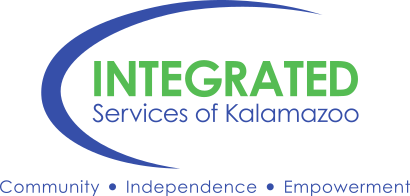

# ISK at Improving Outcomes

**Take-home material from the sessions Integrated Services of Kalamazoo presents at the CMHA Improving Outcomes conference.**

   

---

## About

Integrated Services of Kalamazoo is the community mental health services program for Kalamazoo County, Michigan, and a Certified Community Behavioral Health Clinic. Its IT department designs, builds, deploys, and hosts the agency's own software on servers ISK operates.

When we present at Improving Outcomes, the slides only cover so much. This organization holds the rest: the process documents, templates, and working files behind each session, rewritten so another agency can pick them up and use them.

## Getting access

The repositories are private. To get read access, email **AThomas@iskzoo.org** with your name, your agency, your GitHub username, and the session you attended. You'll be added as a reader: you can browse, clone, and download everything, and open an issue if you have a question.

## Winter 2026 · Ypsilanti

Thursday, November 5, 2026, in the IT track at the Ann Arbor Marriott Ypsilanti at Eagle Crest.

| Session | Presenters | Repository |
|---|---|---|
| **Build, Deploy, Host: Internal Software Development at a CMHSP** 2:00 PM | [Tony Thomas](https://github.com/tthomas-ISK) | [IO-Conference__Build-Deploy-Host](https://github.com/ISK-Improving-Outcomes/IO-Conference__Build-Deploy-Host): a fill-in starter process for agencies new to building software, ISK's own SDLC and templates, and the slides |
| **AI In Action: Prompting, Productivity and Real-World Organizational Use Cases** 3:15 PM | [Warwick Barlow](https://github.com/WBarlowISK) and [Tony Thomas](https://github.com/tthomas-ISK) | [IO-Conference__Agents](https://github.com/ISK-Improving-Outcomes/IO-Conference__Agents): the five Claude Code agent files, hooks, brief, and synthetic sample policies from the live build |

## Using what's here

Everything here is what works at ISK, shared as-is. It isn't a standard or a recommendation, and no other agency's setup will look exactly like ours. Take what fits your agency and change what doesn't. Each repository's license is in its own `LICENSE` file.

## Contact

Questions about any of this, or about building software in-house at an agency like ours, are welcome. Tony Thomas, Senior Manager, Software Development & Standards: AThomas@iskzoo.org.
